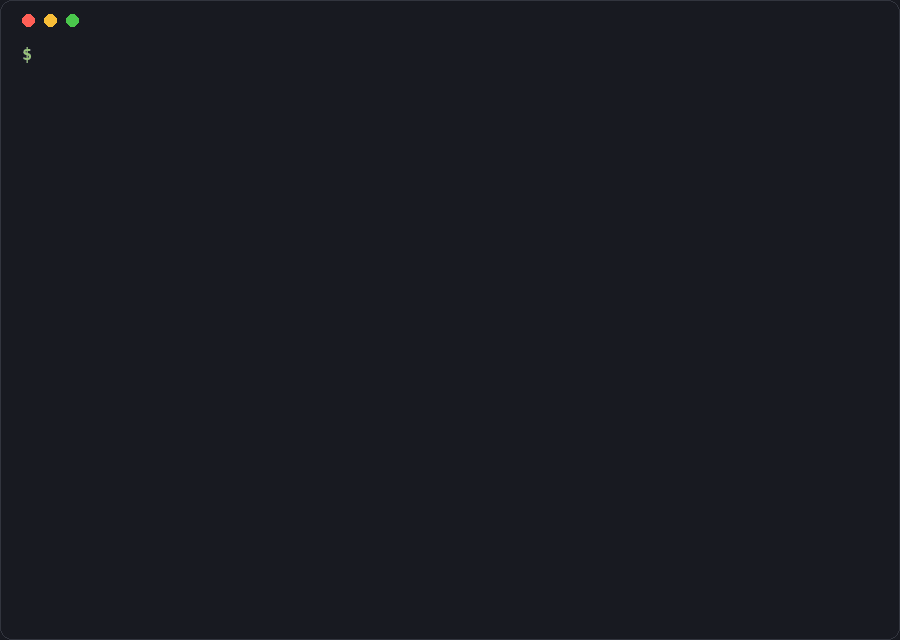

# create-prodforge

Scaffold a production-ready Node.js + TypeScript backend in one command: a web framework, a database with migrations, Docker, PM2, CI, logging, health checks and tests, all wired together and passing from the first commit. You pick what goes in.

```bash
npm create prodforge@latest my-api
# or: pnpm create prodforge my-api · yarn create prodforge my-api · bun create prodforge my-api
```



## Why

Most templates stop at "hello world". The work that makes a backend safe to deploy (validated config, structured logs, graceful shutdown, readiness checks, a Docker image that doesn't run as root, migrations in CI) is left to you. create-prodforge generates all of it, for whichever stack you pick, and its own CI generates, installs, builds and runs every combination to prove they work.

- **Production-ready by default.** Every project ships with Pino logging, Zod-validated env vars, an error handler, `/health` and `/ready`, graceful shutdown, Helmet, CORS and rate limiting.
- **Pick your stack.** Express, Fastify or Hono. Prisma, Drizzle or Mongoose. ESLint + Prettier or Biome. Add Redis, BullMQ, JWT or Better Auth, and OpenTelemetry.
- **Pinned versions that are tested together.** Every dependency version lives in one file, Renovate keeps it current, and the e2e matrix regenerates projects on every change. `--latest` opts out.
- **Nothing hidden.** The output is plain code you own. There's no runtime package from this tool in your project.

## Quick start

```bash
npm create prodforge@latest my-api      # answer a few questions
cd my-api
docker compose up -d postgres           # the database, from the generated compose.yaml
cp .env.example .env
pnpm db:deploy                          # apply the initial migration
pnpm dev                                # http://localhost:3000/health and /docs
```

Skip the questions with `--yes` (the `api` preset) or pick a preset:

```bash
npm create prodforge@latest my-api -- --preset full --yes
```

## Options

Every prompt has a flag. Flags win over a preset, and the prompts only ask what neither settled.

| Flag | Values | Default | What you get |
|---|---|---|---|
| `--framework` | `express`, `fastify`, `hono` | `express` | The HTTP layer, its middleware and tests |
| `--db` | `prisma`, `drizzle`, `mongoose`, `none` | `prisma` | Client, schema, migrations, compose service, readiness check |
| `--example` / `--no-example` | | on with a database | A `users` CRUD module with validation, tests and OpenAPI paths |
| `--auth` | `none`, `jwt`, `better-auth` | `none` | Sign-up, sign-in and a protected `/auth/me` (needs a database) |
| `--cache` | `none`, `redis`, `bullmq` | `none` | A shared Redis connection; `bullmq` adds a job queue and a worker process |
| `--otel` | | off | OpenTelemetry traces for HTTP and database calls |
| `--openapi` / `--no-openapi` | | on | `/openapi.json` from your Zod schemas and a Scalar page at `/docs` |
| `--docker` / `--no-docker` | | on | Multi-stage Dockerfile and `compose.yaml` with every service (pnpm and npm projects) |
| `--pm2` / `--no-pm2` | | on | `ecosystem.config.cjs` for cluster mode outside containers |
| `--ci` / `--no-ci` | | on | GitHub Actions: lint, format, typecheck, test, build, Docker build |
| `--git-hooks` / `--no-git-hooks` | | on | Husky, lint-staged and commitlint |
| `--lint` | `eslint`, `biome` | `eslint` | ESLint + Prettier, or Biome for both |
| `--pm` | `pnpm`, `npm`, `yarn`, `bun` | the one you ran it with | Scripts, CI and Dockerfile for that package manager |
| `--node` | `24`, `22` | `24` | `engines`, `.nvmrc` and the Docker base image |
| `--no-install`, `--no-git` | | | Skip installing dependencies or `git init` |
| `--preset` | `minimal`, `api`, `full`, or `./file.json` | | Start from a preset (below) |
| `--dry-run` | | | Print the file tree and `package.json` without writing anything |
| `--latest` | | | Use npm's latest versions instead of the tested pins (prints a warning) |
| `--force` | | | Write into a directory that isn't empty |

### Presets

| | `minimal` | `api` (= `--yes`) | `full` |
|---|---|---|---|
| Framework | Express | Express | Express |
| Database | none | Prisma + Postgres | Prisma + Postgres |
| Example module | off | on | on |
| OpenAPI | off | on | on |
| Docker / PM2 / CI | Docker only | all on | all on |
| Git hooks | off | on | on |
| Redis + BullMQ, Better Auth, OpenTelemetry | off | off | on |

Teams can keep their own preset in a JSON file. It takes any option except the project name, install and git, and unknown keys are an error:

```json
{
  "framework": "fastify",
  "db": "drizzle",
  "lint": "biome",
  "auth": "jwt",
  "otel": true
}
```

```bash
npm create prodforge@latest my-api -- --preset ./team-preset.json
```

## What's in a generated project

```
my-api/
├─ src/
│  ├─ config/env.ts            # Zod-validated environment, fails fast on bad config
│  ├─ lib/                     # logger, readiness checks, Redis, auth helpers
│  ├─ middleware/              # error handler
│  ├─ modules/                 # health, users (example), auth: routes + schemas + service
│  ├─ db/                      # client and schema for your ORM
│  ├─ app.ts                   # builds the app (importable in tests, no port opened)
│  ├─ server.ts                # starts it, connects services, shuts down gracefully
│  └─ worker.ts                # BullMQ worker (with --cache bullmq)
├─ tests/                      # Vitest, no database needed
├─ prisma/ or drizzle/         # migrations
├─ Dockerfile, compose.yaml    # app, migrate, worker and service containers
├─ ecosystem.config.cjs        # PM2
├─ .github/workflows/ci.yml
└─ README.md                   # how to run, test and deploy this project
```

Every project has the same scripts, whatever you picked: `dev`, `build`, `start`, `test`, `lint`, `format`, `typecheck`, plus `db:*` for databases and `dev:worker` / `start:worker` for BullMQ.

## Why each dependency is there

Each pick is explained in [docs/decisions.md](./docs/decisions.md). The short version:

- **Zod** validates env vars and request bodies, and OpenAPI is generated from the same schemas.
- **Pino** writes JSON logs fast, with request ids, and pretty logs in development.
- **tsx** runs TypeScript in development, and **tsdown** bundles it for production.
- **Vitest** runs tests without a database: repositories are swapped for in-memory ones.
- **Helmet, CORS and a rate limiter** are on by default, configured through env vars.
- **PM2** runs the build in cluster mode on a VM. In Docker, the container runtime does that job, so PM2 isn't used there.

## Development

```bash
pnpm install
pnpm dev -- my-app      # run the CLI from source
pnpm test               # unit and snapshot tests
pnpm test:e2e           # generate → install → lint/test/build → run, against real services
```

See [CONTRIBUTING.md](./CONTRIBUTING.md) and [PLAN.md](./PLAN.md) for the architecture. Every dependency version used in generated projects lives in [`src/core/versions.ts`](./src/core/versions.ts).

## License

MIT
